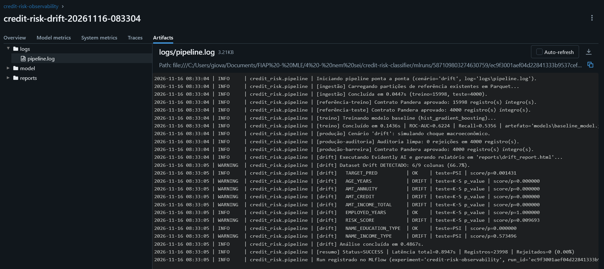
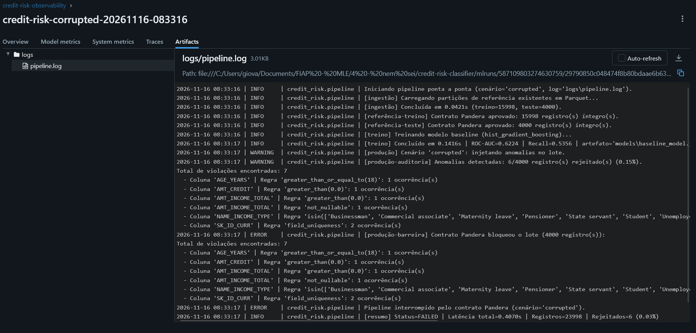

# Evidências de Observabilidade e Tracking Integrado (MLflow + Logs + Evidently AI)

Este documento detalha o funcionamento prático da observabilidade ponta a ponta implementada em [`scripts/run_pipeline.py`](../scripts/run_pipeline.py) e [`src/credit_risk/observability.py`](../src/credit_risk/observability.py), com evidências visuais extraídas do **MLflow UI** (`make mlflow-ui`) nos três cenários de execução (`clean`, `drift` e `corrupted`).

---

## 1. Visão Geral dos Runs no MLflow

Cada execução do pipeline gera um run com nome padronizado contendo o cenário e o timestamp (`credit-risk-<cenário>-<YYYYMMDD-HHMMSS>`), facilitando a comparação histórica e a rastreabilidade entre execuções estáveis, execuções com *drift* e execuções bloqueadas por falha de contrato.

---

## 2. Consolidação de Métricas Operacionais, Qualidade e Drift

Em cada run, o MLflow centraliza parâmetros de execução e as métricas de [`PipelineHealthMetrics`](../src/credit_risk/observability.py) (status do pipeline, latências por etapa e total, volume recebido/rejeitado, métricas do modelo baseline e indicadores de *drift* do Evidently AI):

---

## 3. Reação dos Logs Centralizados por Cenário

O arquivo `logs/pipeline.log` (gerado em modo isolado por execução) é anexado como artefato em `logs/pipeline.log` dentro do próprio run no MLflow, integrando os eventos de ingestão, validação Pandera e análise do Evidently AI.

### 3.1 Cenário Estável (`make pipeline-clean`)
Sem choque econômico aplicado: o contrato Pandera aprova 100% dos registros e o Evidently AI confirma ausência de *Dataset Drift* (`0/9` colunas), finalizando com `Status=SUCCESS`.

### 3.2 Cenário com Choque Econômico (`make pipeline-drift`)
Com o choque simulado (`simulate_economic_shock`), o pipeline conclui o treino e a inferência (`Status=SUCCESS`), mas o módulo de observabilidade registra alertas `WARNING` para o *Dataset Drift* global (`6/9` colunas = `66,7%`) e para cada variável afetada (K-S / PSI), além de anexar o relatório HTML em `reports/drift_report.html`.

### 3.3 Cenário com Lote Corrompido (`make pipeline-corrupted`)
Quando anomalias intencionais são injetadas (`build_corrupted_batch`), a auditoria calcula a taxa de rejeição (`6/4000` registros = `0,15%` do lote de produção) e a barreira estrita do Pandera bloqueia a inferência emitindo `ERROR` com todas as regras violadas. O bloco `finally` garante o registro do run com status `FAILED` e o envio do log de erro para o MLflow.

