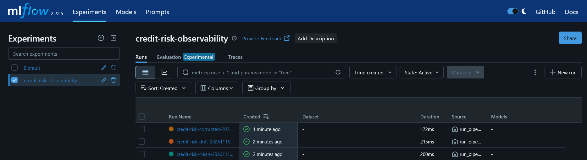
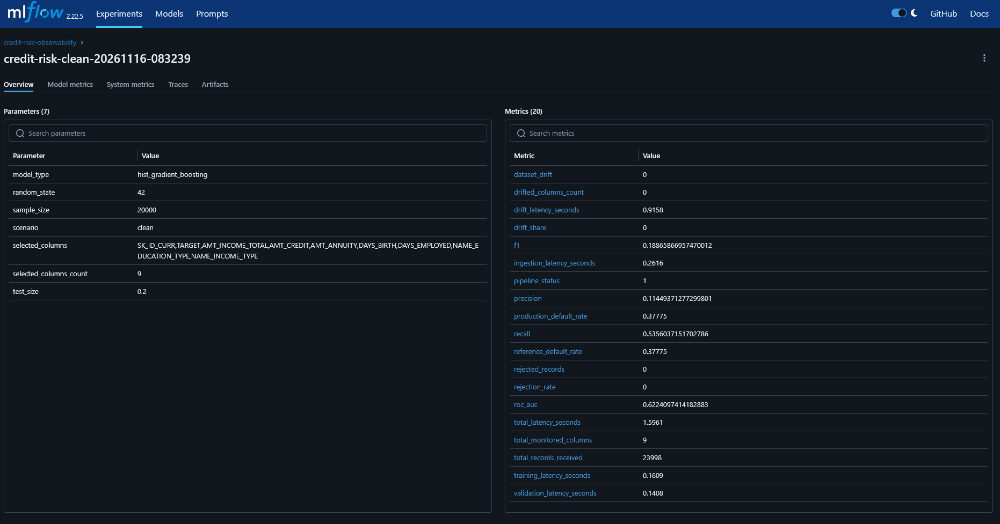
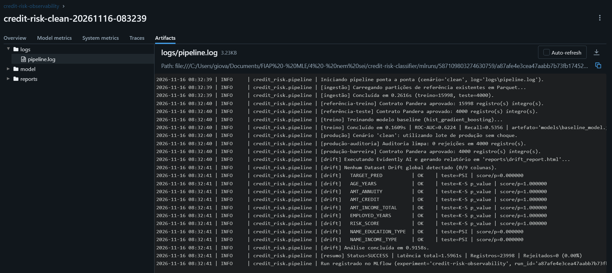

# Evidências de Observabilidade e Tracking Integrado (MLflow + Logs + Evidently AI)

Este documento detalha o funcionamento prático da observabilidade ponta a ponta implementada em [`scripts/run_pipeline.py`](../scripts/run_pipeline.py) e [`src/credit_risk/observability.py`](../src/credit_risk/observability.py), com evidências visuais extraídas do **MLflow UI** (`make mlflow-ui`) nos três cenários de execução (`clean`, `drift` e `corrupted`).

---

## 1. Visão Geral dos Runs no MLflow

Cada execução do pipeline gera um run com nome padronizado contendo o cenário e o timestamp (`credit-risk-<cenário>-<YYYYMMDD-HHMMSS>`), facilitando a comparação histórica e a rastreabilidade entre execuções estáveis, execuções com *drift* e execuções bloqueadas por falha de contrato.



---

## 2. Consolidação de Métricas Operacionais, Qualidade e Drift

Em cada run, o MLflow centraliza parâmetros de execução e as métricas de [`PipelineHealthMetrics`](../src/credit_risk/observability.py) (status do pipeline, latências por etapa e total, volume recebido/rejeitado, métricas do modelo baseline e indicadores de *drift* do Evidently AI):



---

## 3. Reação dos Logs Centralizados por Cenário

O arquivo `logs/pipeline.log` (gerado em modo isolado por execução) é anexado como artefato em `logs/pipeline.log` dentro do próprio run no MLflow, integrando os eventos de ingestão, validação Pandera e análise do Evidently AI.

### 3.1 Cenário Estável (`make pipeline-clean`)
Sem choque econômico aplicado: o contrato Pandera aprova 100% dos registros e o Evidently AI confirma ausência de *Dataset Drift* (`0/9` colunas), finalizando com `Status=SUCCESS`.



### 3.2 Cenário com Choque Econômico (`make pipeline-drift`)
Com o choque simulado (`simulate_economic_shock`), o pipeline conclui o treino e a inferência (`Status=SUCCESS`), mas o módulo de observabilidade registra alertas `WARNING` para o *Dataset Drift* global (`6/9` colunas = `66,7%`) e para cada variável afetada (K-S / PSI), além de anexar o relatório HTML em `reports/drift_report.html`.


### 3.3 Cenário com Lote Corrompido (`make pipeline-corrupted`)
Quando anomalias intencionais são injetadas (`build_corrupted_batch`), a auditoria calcula a taxa de rejeição (`6/4000` registros = `0,15%` do lote de produção) e a barreira estrita do Pandera bloqueia a inferência emitindo `ERROR` com todas as regras violadas. O bloco `finally` garante o registro do run com status `FAILED` e o envio do log de erro para o MLflow.


### 3.4 Concept Drift, Fairness e Infraestrutura no Log Centralizado
A partir desta versão, o cenário `drift` também simula Concept Drift (`simulate_concept_drift`) e registra no mesmo log e no mesmo run do MLflow:

```text
WARNING | [concept] ROC-AUC referência=0.6224 -> produção=0.5052 (queda=0.1172) | Recall 0.5356 -> 0.3476 | ALERTA DE DEGRADAÇÃO
WARNING | [concept] Drift do alvo real (TARGET): DETECTADO | teste=z | p=0.000000
WARNING | [fairness] produção   | AGE_BAND             | disparate_impact=0.521 | gap_negação=0.405 | menos aprovado=18-25 | ALERTA
INFO    | [infra] Memória do processo=355.8 MB | CPU do processo=13.58s | CPU host=45.3% | Memória host=71.6% | Alertas totais=14
```

Os relatórios `model_performance_report.html` e `fairness_report.html` são anexados na pasta `reports/` dos artefatos do run, ao lado de `drift_report.html`. As capturas de tela acima são de uma versão anterior e não mostram essas novas métricas (`production_roc_auc`, `roc_auc_drop`, `target_drift`, `fairness_di_*`, `process_memory_mb`, `total_alerts_count`). Para vê-las, execute `make pipeline-drift` e `make mlflow-ui`.
